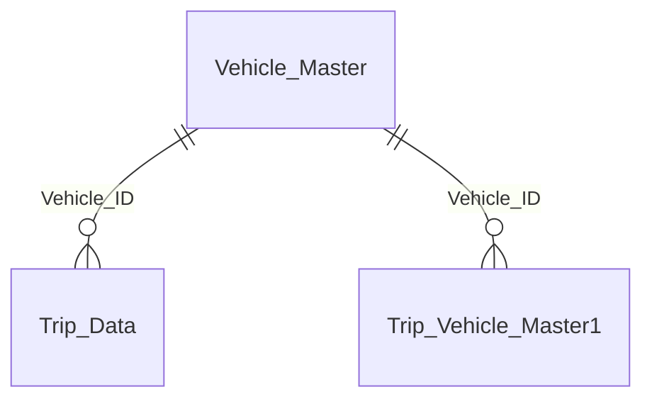

# Logistics & Transportation – Fleet Performance & Delivery Efficiency

## 1. Project Overview

This project analyzes the fleet performance of a logistics company using Microsoft Excel and Power BI. The dashboard helps monitor on-time deliveries, fuel efficiency, transportation costs and delivery performance across different routes.

### Objectives

- Measure fuel efficiency in kilometers per liter (km/L).
- Analyze on-time delivery performance by route.
- Calculate transportation cost per kilometer.
- Monitor monthly fuel efficiency trends.
- Estimate average delivery time and visualize delivery locations.
- Enable interactive analysis using filters and slicers.

## 2. Tools and Dataset

- **Microsoft Excel:** Data cleaning and preparation.
- **Power BI Desktop:** Data modeling, DAX measures and dashboard creation.
- **DAX (Data Analysis Expressions):** KPI calculations.


### Dataset fields

| Trips | Description |
| --- | --- |
| Trip ID (`Projects` in the working table) | Unique trip identifier |
| Vehicle_ID | Vehicle identifier |
| Driver_ID | Driver identifier |
| Origin | Starting city |
| Destination | Delivery city |
| Distance_km | Distance traveled in kilometers |
| Fuel_Consumed_L | Fuel consumed in liters |
| Delivery_Status | On-Time or Late |
| Delivery_Date | Delivery date (split into day, month and year in the working table) |

| Vehicle Master | Description |
| --- | --- |
| Vehicle_ID | Unique vehicle identifier |
| Vehicle_Type | Type of vehicle |
| Capacity_kg | Vehicle capacity in kilograms |
| Maintenance_Cost | Vehicle maintenance cost |

## 3. Data Cleaning and Modeling

### 3.1 Handle missing fuel consumption values

Missing fuel consumption values are handled using the average fuel consumption of vehicles belonging to the same vehicle type.

Steps in Excel:

1. Identify blank values in the fuel consumption column.
2. Obtain the vehicle type for each trip using the Vehicle Master table.
3. Create a new column named `Cleaned_Fuel_Consumption`.
4. Use the following formula in the first data row and fill it down:

```excel
=IF(G2="",ROUND(AVERAGEIF($J$2:$J$51,J2,$G$2:$G$51),2),G2)
```

**Formula explanation:**

- `IF(G2="", ..., G2)` checks whether fuel consumption is missing. If it is available, the original value is retained.
- `AVERAGEIF($J$2:$J$51,J2,$G$2:$G$51)` calculates the average available fuel consumption for the same vehicle type.
- `ROUND(...,2)` rounds the replacement value to two decimal places.
- Column G contains fuel consumption and column J contains vehicle type in this example. Adjust the ranges if the dataset changes.

If a vehicle type has no available fuel readings, its missing values need a separate documented treatment.

### 3.2 Merge Trips with Vehicle Master

Use `Vehicle_ID` as the common field to bring Vehicle_Type, Capacity_kg and Maintenance_Cost into the trip data. Excel XLOOKUP or Power Query Merge can be used for this step.

The working reporting table is named `Trip_Vehicle_Master1`.

### 3.3 Create table relationships in Power BI

1. Open Power BI Desktop and load the Excel tables.
2. Open **Model View → Manage relationships**.
3. Connect `Vehicle_Master[Vehicle_ID]` to `Trip_Data[Vehicle_ID]`.
4. Connect `Vehicle_Master[Vehicle_ID]` to `Trip_Vehicle_Master1[Vehicle_ID]`.
5. Set both relationships to one-to-many (1:*) from Vehicle Master to the trip tables, single cross-filter direction and active status.



One vehicle can complete multiple trips. The relationships allow vehicle information to filter trip data without joining the two trip tables directly.

### 3.4 Create route and month columns

Select `Trip_Vehicle_Master1` and choose **New column**.

```dax
Route = Trip_Vehicle_Master1[Origin] & " - " & Trip_Vehicle_Master1[Destination]
```

This combines origin and destination into a route label such as Delhi - Pune.

```dax
Month Name = FORMAT(DATE(2023, Trip_Vehicle_Master1[Delivery_Month], 1), "MMMM")
```

This converts the numeric month to its name. Select `Month Name` → **Column tools → Sort by column → Delivery_Month**. This keeps months in calendar order. The dataset uses 2023; for multi-year analysis, use a proper date or year-month column.

## 4. DAX Measures

DAX measures calculate values dynamically based on the filters selected in the dashboard. To create a measure, select the reporting table and choose **Modeling → New measure**.

### 4.1 Supporting measures

The following supporting formulas can be used to reproduce the KPI calculations. The fuel price is an illustrative assumption and should match the final report.

```dax
Total Trips = COUNTROWS(Trip_Vehicle_Master1)
```

Counts trip rows, assuming each row represents one unique trip.

```dax
On-Time Trips =
CALCULATE(
    [Total Trips],
    Trip_Vehicle_Master1[Delivery_Status] = "On-Time"
)
```

`CALCULATE` evaluates Total Trips for on-time deliveries while retaining other relevant filters such as route and month.

```dax
Total Distance = SUM(Trip_Vehicle_Master1[Distance_km])
```

Adds the distance traveled by the selected trips.

```dax
Fuel Cost = SUM(Trip_Vehicle_Master1[Cleaned_Fuel_Consumption]) * 95
```

Multiplies fuel consumption by an assumed fuel price of ₹95 per liter. The source data does not include fuel price; confirm or replace this rate with the one used in the final report.

```dax
Total Maintainance Cost = SUM(Vehicle_Master[Maintenance_Cost])
```

Adds maintenance costs from the Vehicle Master table so that each vehicle is counted once rather than once for every trip. This assumes maintenance cost is a total per vehicle for the reporting period. The existing measure spelling is retained for compatibility.

**Filter limitation:** With single-direction relationships, month and route filters on the trip table do not automatically filter maintenance costs in Vehicle Master. For accurate filtered cost analysis, allocate maintenance to trips using a documented method (for example, each trip's share of its vehicle's total distance during the reporting period).

### 4.2 Fuel Efficiency

**Formula:** Fuel Efficiency = Total Distance / Total Fuel Consumed

```dax
Fuel Efficiency =
DIVIDE(
    SUM(Trip_Vehicle_Master1[Distance_km]),
    SUM(Trip_Vehicle_Master1[Fuel_Consumed_L]),
    0
)
```

**Explanation:**

- `SUM(Distance_km)` calculates the total distance traveled.
- `SUM(Fuel_Consumed_L)` calculates total fuel consumed.
- `DIVIDE(numerator, denominator, 0)` performs safe division and returns 0 when the denominator is zero or blank.
- The result is in km/L. A higher value generally represents better fuel efficiency.

**Example:** A vehicle travels 600 km using 50 liters of fuel. Fuel efficiency = 600 / 50 = 12 km/L.

The supplied project formula uses `Fuel_Consumed_L`. If missing values were filled in a separate `Cleaned_Fuel_Consumption` column, use that cleaned column in the denominator instead, unless the original fuel column was already updated. This ensures that all trips are included consistently.

### 4.3 On-Time Delivery Percentage

**Formula:** On-Time Delivery % = On-Time Trips / Total Trips

```dax
On-Time-Delivery% = DIVIDE([On-Time Trips],[Total Trips],0)
```

**Explanation:**

- `[On-Time Trips]` counts trips with an On-Time delivery status.
- `[Total Trips]` counts all trips in the current filter context.
- `DIVIDE` calculates the ratio safely.
- Set the measure format to **Percentage** with two decimal places. Do not multiply by 100 separately.

**Example:** 30 on-time deliveries out of 50 trips = 0.60 = 60%.

This KPI measures delivery reliability and helps identify routes that need improvement.

### 4.4 Cost per km

**Formula:** Cost per km = (Fuel Cost + Maintenance Cost) / Total Distance

```dax
Cost per km = DIVIDE([Fuel Cost]+[Total Maintainance Cost],[Total Distance],0)
```

**Explanation:**

- `[Fuel Cost]` is the estimated fuel expense.
- `[Total Maintainance Cost]` represents maintenance expense under the chosen costing assumptions.
- The numerator adds both expenses.
- `[Total Distance]` is the distance traveled in kilometers.
- `DIVIDE` returns the cost per kilometer safely.

**Example:** If fuel costs ₹4,000, maintenance costs ₹1,000 and distance is 500 km, cost per km = (4,000 + 1,000) / 500 = ₹10/km.

Format the result to two decimal places. Lower costs may indicate better cost efficiency, subject to vehicle type, load and route conditions. This is a fuel-and-maintenance cost metric, not the complete operating cost of the fleet.

### 4.5 Estimated Average Delivery Time

The source dataset does not include departure time, arrival time or delivery duration. Therefore, delivery time is estimated using an assumed average speed of 60 km/h.

```dax
Avg. Delivery Time =
DIVIDE(AVERAGE(Trip_Vehicle_Master1[Distance_km]), 60, 0)
```

- `AVERAGE(Distance_km)` calculates the average trip distance.
- Dividing by 60 km/h gives estimated driving time in hours.
- Format the measure to two decimal places and label it **Estimated Avg. Delivery Time (hrs)**.

This estimate excludes loading, unloading, traffic delays and rest stops.

## 5. Dashboard Visualization

### 5.1 Bar chart – On-Time Delivery % by Route

1. Insert a clustered bar chart.
2. Add `Route` to the Y-axis.
3. Add `On-Time-Delivery%` to the X-axis.
4. Enable data labels and format them as percentages.
5. Sort by on-time delivery percentage in descending order.

**Purpose:** Compare delivery reliability across routes and identify routes with lower on-time delivery percentages.

### 5.2 Line chart – Monthly Fuel Efficiency Trend

1. Insert a line chart.
2. Add `Month Name` to the X-axis.
3. Add `Fuel Efficiency` to the Y-axis.
4. Sort the month column by `Delivery_Month` and the visual by month ascending.
5. Enable data labels.

**Purpose:** Monitor changes in fuel efficiency over time.

### 5.3 KPI cards

Insert a Card visual for each measure:

| KPI | Unit | Purpose |
| --- | --- | --- |
| Fuel Efficiency | km/L | Monitor fuel usage efficiency |
| Cost per km | ₹/km | Monitor transportation cost |
| On-Time Delivery | % | Monitor delivery reliability |
| Estimated Avg. Delivery Time | Hours | Estimate average driving duration |

Use clear labels and two decimal places where appropriate.

### 5.4 Map – Delivery Performance

The reviewed dashboard uses a destination map with delivery status to show where deliveries are on time or late.

To recreate the destination map, add a Map visual, set Location to `Destination`, Legend to `Delivery_Status`, Size to `Total Trips`, and add route and delivery performance measures as tooltips. Use green for On-Time and red for Late.

**Origin → Destination enhancement (implementation to be verified):** To display actual city-to-city connections, use an Azure Maps visual with a Path layer.

1. Create a `Route_Map` table with two rows per trip: origin (point order 1) and destination (point order 2). Include the trip ID, route and delivery status in each row.
2. Relate `Trip_Vehicle_Master1[Projects]` (1) to `Route_Map[Trip_ID]` (*) with single-direction filtering.
3. Add the city to Location, trip ID to Path ID, point order to Point Order and delivery status to Legend. Configure the Path layer in Azure Maps if supported by your Power BI version.
4. Add route details as tooltips and test the existing slicers.

These connections represent origin-to-destination links, not actual GPS-tracked road routes.

### 5.5 Interactive dashboard and slicers

Add three slicers using the following fields:

- `Month Name` – Filter deliveries by month.
- `Vehicle_Type` – Compare vehicle categories.
- `Route` – Analyze a selected origin-to-destination route.

Use **Format → Edit interactions** to verify that slicers filter the intended visuals. Test each slicer individually and in combination, and clear filters to return to the overall dashboard.

## 6. Dashboard Results

The reviewed dashboard screenshot displayed the following unfiltered results:

| KPI | Value |
| --- | ---: |
| Fuel Efficiency | 11.57 km/L |
| On-Time Delivery | 60.00% |
| Cost per km | 9.63 (estimated cost units/km) |
| Estimated Average Delivery Time | 17.85 hours |
| January Fuel Efficiency | 11.89 km/L |
| February Fuel Efficiency | 11.39 km/L |

The fuel price behind the displayed cost KPI was not independently confirmed. The estimated time uses the 60 km/h assumption. Verify these assumptions against the final PBIX file before publishing.

### Key insights

- 60% of deliveries were on time; the remaining 40% were late.
- Fuel efficiency decreased from January to February.
- Route-level delivery comparisons help identify areas for improvement.
- Fuel and maintenance cost monitoring can support fleet utilization and cost-control decisions.

## 7. Project Files and How to Use

| File | Description |
| --- | --- |
| `logistics_project.xlsx` | Prepared Excel dataset |
| `Logistics_Project.pbix` | Power BI dashboard and data model |
| `README.md` | Project documentation and reproduction steps |

1. Download the Excel and PBIX files from the repository after uploading them.
2. Open `Logistics_Project.pbix` in Power BI Desktop.
3. If the Excel source path differs on your computer, open **Transform data → Data source settings → Change Source** and select the downloaded workbook.
4. Refresh the data and use the slicers to explore the dashboard.

## 8. Conclusion

This dashboard provides a centralized view of fleet efficiency, delivery reliability and transportation cost. It supports data-driven decisions for route optimization, fuel management and fleet utilization. Future improvements include actual delivery timestamps, recorded fuel prices, trip-level maintenance allocation and GPS route information.
